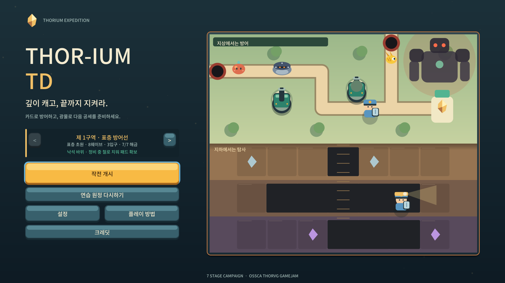
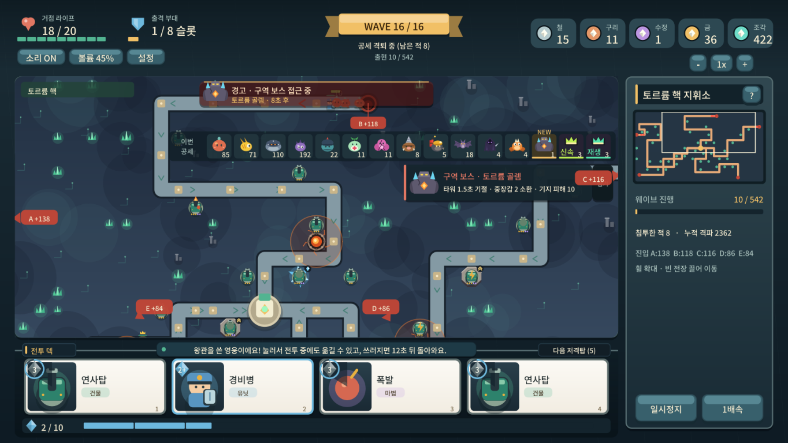
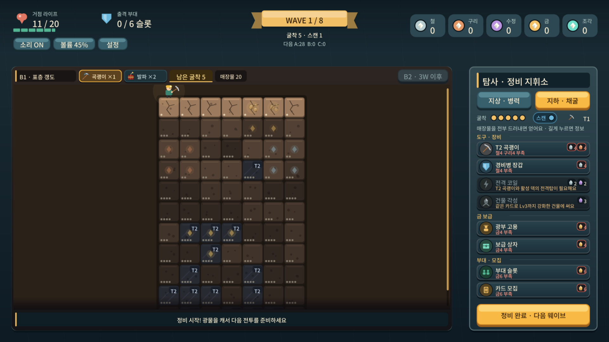
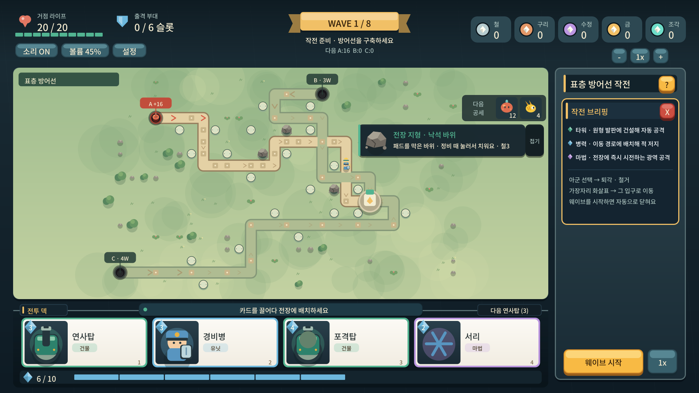

# Thor-ium TD

> 깊이 캐고, 끝까지 지켜라.

**Thor-ium TD**는 카드로 건물·유닛·마법을 운용해 몰려오는 적에게서 거점을 지키고, 웨이브 사이에는 지하를 채굴해 다음 방어를 준비하는 **타워 디펜스 × 채굴** 웹 게임입니다. OSSCA × ThorVG 2026 게임잼(ThorJam) 출품작이며 화면의 모든 그래픽(게임 장면·메뉴·HUD)을 [ThorVG](https://github.com/thorvg/thorvg)로 그립니다.

- **플레이 (GitHub Pages):** <https://ossca-thorvg.github.io/GameJam-Thor-ium-TD/>
- 설치 없이 브라우저에서 실행됩니다. 데스크톱 마우스·키보드와 모바일 터치를 지원합니다.
- 처음이라면 메인 화면의 **연습 원정**(3~4분)부터 해 보세요.

## 스크린샷

| 지상 방어 (5구역 후반 공세) | 지하 채굴 (정비) | 출격 준비 (1구역) |
| --- | --- | --- |
|  |  |  |

## 게임 방법

1. **전투 (지상):** 손패의 카드를 끌어다 놓아 건물(패드)·유닛(길 위 칸)·마법을 배치합니다. 에너지가 시간이 지나며 차오릅니다. 같은 건물 카드를 같은 건물에 쓰면 강화, 다른 건물 카드를 쓰면 교체됩니다.
2. **정비 (지하):** 웨이브가 끝나면 지하로 내려가 정비마다 정해진 횟수만큼 굴착합니다. 숫자는 주변 8칸의 둥지 수이고, 스캔으로 경계 한 칸을 미리 봅니다. 암벽 발굴(겹 벗기기)과 갱도 탐사 두 방식이 있고 설정의 원정 탭에서 바꿉니다.
3. **성장:** 철·구리·수정으로 곡괭이·장비를 제작하고 금으로 부대 슬롯을 늘리거나 유닛 카드를 모집합니다. 전투에서 모은 조각으로는 영웅을 훈련하고 모집을 다시 돌립니다.
4. **승리:** 마지막 웨이브까지 거점을 지키면 구역 클리어, 다음 구역이 열립니다. 7개 구역마다 전장 기믹(낙석 바위·특성 패드·갱도 터널·용암 분출구·광차 선로·늪·가스통)과 구역 보스 골렘이 있습니다.

적은 16종(보스 포함)으로 날아다니는 박쥐, 가까이 와야 보이는 그림자, 건물을 부수는 망치병, 저지를 뛰어넘는 도약꾼처럼 저마다 대응 방식이 다릅니다. 자세한 규칙은 [문서 목차](docs/README.md)에 있습니다.

## 조작법

| 입력 | 동작 |
| --- | --- |
| 카드 클릭·탭 → 대상 클릭·탭 | 배치·마법 사용 |
| 카드 드래그 → 전장 | 배치 (전장 밖에 놓으면 취소) |
| 배치한 건물·유닛 클릭 | 사거리·상태 확인, 철수 |
| 1 ~ 4 | 손패 선택 |
| Space | 웨이브 시작 / 일시정지·계속 |
| Esc | 선택·팝업 취소, 전투 일시정지 |
| M | 정비 중 지상 / 지하 전환 |
| Tab · Shift+Tab · Enter | 버튼 이동·실행 |
| S · V | 효과음 음소거 · 볼륨 |
| + · − · 0, 마우스 휠 | 전장 확대·축소·맞춤 |
| 지하: 타일 클릭 | 광부가 이동해 굴착 |

## 사용한 ThorVG 기능

SDL3 + C++17 코드를 WebAssembly로 빌드하고 ThorVG(`SwCanvas`, 소프트웨어 렌더러)가 그린 픽셀을 캔버스에 올립니다.

| 기능 | 쓰는 곳 | 코드 |
| --- | --- | --- |
| Lottie (`LottieAnimation`, 마커 구간) | 적 16종의 대기·이동·공격·사망 클립, 시작 화면의 ThorVG 스플래시 | [Renderer.cpp](src/engine/render/Renderer.cpp), [AnimationRendering.cpp](src/engine/render/AnimationRendering.cpp), [Animation.cpp](src/engine/animation/Animation.cpp) |
| Lottie 프레임 굽기·공유 | 같은 클립의 프레임을 한 번만 래스터화해 수백 마리가 공유 | [AnimationFrameBaker.cpp](src/engine/render/AnimationFrameBaker.cpp), [AnimationCache.cpp](src/engine/render/AnimationCache.cpp) |
| `Shape` · `Scene` | 지형·타워·유닛·사거리·HUD 전부 | [Renderer.cpp](src/engine/render/Renderer.cpp), [Battlefield.cpp](src/game/presentation/Battlefield.cpp) |
| `LinearGradient` · `RadialGradient` | 패널·지층 음영, 보스 오라와 용암 분출구의 빛무리 | [Renderer.cpp](src/engine/render/Renderer.cpp) |
| 점선 스트로크 (`strokeDash`) | 분출구 범위와 보스 기절 예고 원 | [Renderer.cpp](src/engine/render/Renderer.cpp), [TerrainArt.h](src/game/presentation/TerrainArt.h) |
| `Picture` (SVG) | 채굴 화면의 광석·도구·유물 그림 | [content/art/ore-gold.svg](content/art/ore-gold.svg) 외 |
| `Text` + TTF 로더 | 한글 UI 텍스트 (Noto Sans KR 부분 집합) | [Renderer.cpp](src/engine/render/Renderer.cpp) |
| 클립 레이어 · 불투명도 | 패널·스크롤 영역 | [Renderer.cpp](src/engine/render/Renderer.cpp) |
| 보관 레이어 · 배경 캐시 | 정지한 지형·배경을 다시 그리지 않고 재사용 | [frame-budget.md](docs/frame-budget.md) |

적 Lottie 16개는 [tools/make_assets.py](tools/make_assets.py)가 만든 자체 제작 파일입니다.

## 빌드와 실행

Python 3.12+, C++17 컴파일러, Meson, Ninja, pkg-config가 필요하고 웹 빌드에는 Emscripten SDK(6.0.0 검증)가 더 필요합니다. 자세한 전제 조건은 [실행 안내](docs/implementation-v0.1.md)에 있습니다.

~~~sh
python3 tools/build.py native
./build/native/thorium

python3 tools/build.py web
python3 -m http.server 8317 --bind 127.0.0.1 --directory dist
~~~

- 문서 검사: `python3 -m unittest discover -s tests -p 'test_*.py' -v`
- `main` 브랜치에 푸시하면 [GitHub Actions](.github/workflows/deploy-pages.yml)가 네이티브 테스트·WASM 빌드·브라우저 E2E를 통과시킨 뒤 Pages에 배포합니다.

## 팀

| 역할 | 담당 |
| --- | --- |
| 기획 · 개발 | [@hd1534](https://github.com/hd1534) |

## Credits

| 항목 | 출처 · 라이선스 |
| --- | --- |
| ThorVG 1.0.0 | [thorvg/thorvg](https://github.com/thorvg/thorvg), MIT |
| "Powered by ThorVG" 스플래시 Lottie | ThorVG 공식 에셋, 수정 없이 사용 ([content/animations/powered-by-thorvg.json](content/animations/powered-by-thorvg.json)) |
| SDL 3.4.18 | [libsdl-org/SDL](https://github.com/libsdl-org/SDL), zlib |
| Noto Sans KR | [Google Fonts](https://github.com/google/fonts/tree/main/ofl/notosanskr), SIL OFL 1.1 |
| dr_mp3 | [mackron/dr_libs](https://github.com/mackron/dr_libs), 퍼블릭 도메인 또는 MIT-0 |
| 배경음악 `content/audio/bgm.mp3` | Google Flow Music(AI 음악 생성)으로 이 게임을 위해 생성. Google 약관은 생성물의 소유권을 주장하지 않는다고 하며, 재사용은 Flow Music 약관과 생성 당시 플랜을 따름. MIT 적용 대상 아님 |
| 효과음 | 실행 중 합성하는 자체 제작 음 |
| 적 Lottie · 타워·유닛·UI 그림 · 광석 SVG | 자체 제작 (생성 스크립트: [make_assets.py](tools/make_assets.py), [make_art.py](tools/make_art.py)) |

전체 목록과 고정 버전은 [THIRD_PARTY.md](THIRD_PARTY.md), [dependencies.lock.json](dependencies.lock.json)에 있습니다.

## License

소스 코드는 [MIT License](LICENSE)입니다. 위 표의 외부 구성요소와 스플래시 애니메이션은 각자의 라이선스를 따릅니다.

## 문서

기획·설계·구현 기록과 날짜별 변경 내역은 [docs/README.md](docs/README.md)에서 볼 수 있습니다.
