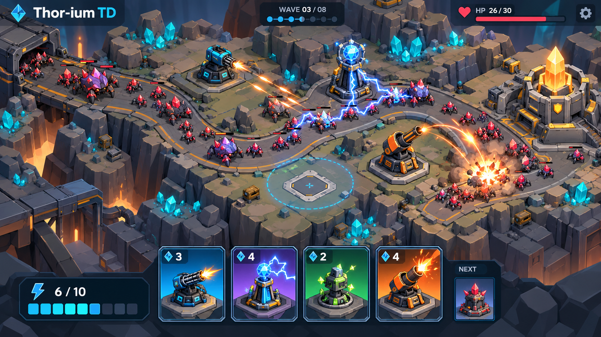
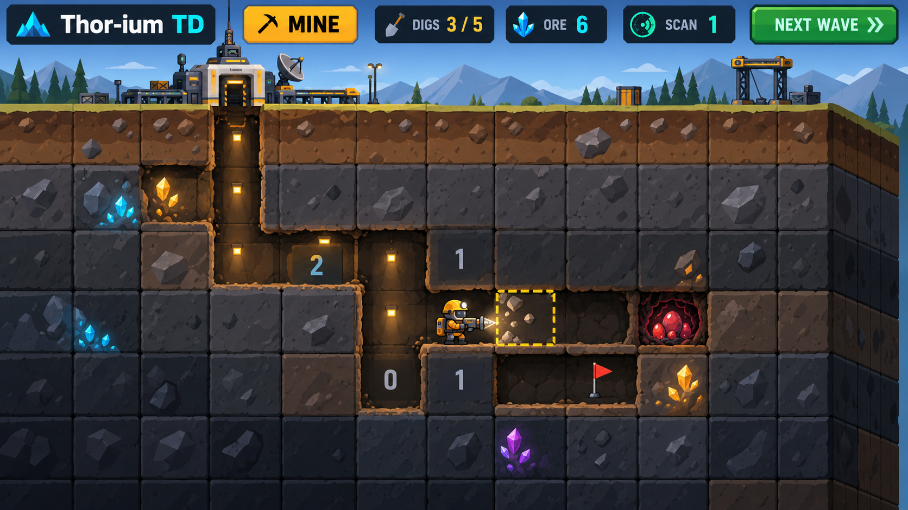
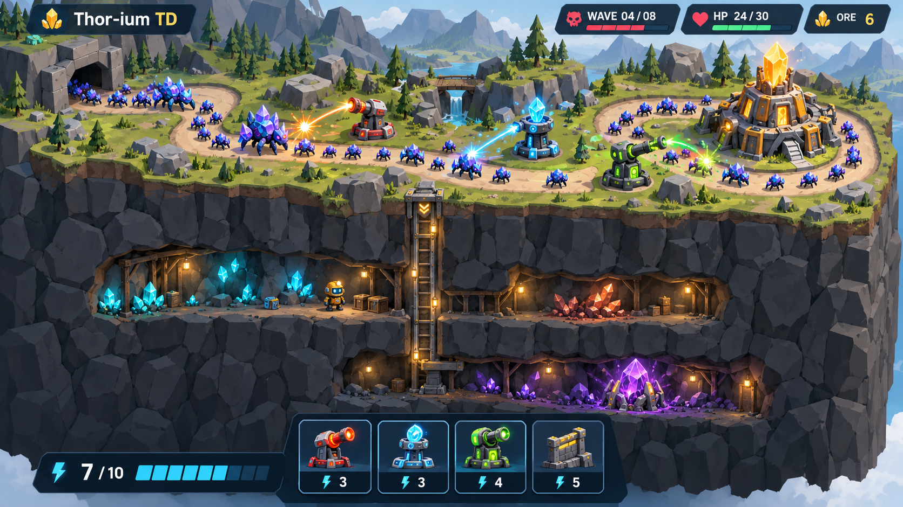

# 화면 컨셉 시안

작성일: 2026-10-31. 생성 도구: 내장 `image_gen`.

화면 구성과 분위기를 검토하기 위한 시안 3장입니다. 수정 생물·기계형 타워·광산의 외형은 이번 시안의 표현 제안이며 확정된 아트 스타일은 아닙니다. 카드 아이콘·수치와 지하 숫자는 화면 표현용입니다. 현재 방향은 [통합 기획](../game-design.md), 검증용 규칙 제안은 [프로토타입 상세안](../prototype-plan.md)을 참고하며 확정 여부는 [결정 기록](../decisions.md)을 따릅니다.

시안 확인 후 선택한 방향은 **구성은 참고하되 그래픽은 더 캐주얼한 2D로 표현**하는 것입니다. 이 이미지의 세밀한 질감·입체 렌더링을 최종 에셋 제작 기준으로 삼지 않습니다.

| 시안 | 검토할 부분 |
| --- | --- |
| [지상 전투](surface-defense-v1.png) | 물량, 타워 배치, 전투 효과, 하단 손패 가독성 |
| [지하 채굴](cutaway-mining-v1.png) | 지층 절단면, 파낸 갱도, 숫자·광맥·광부와 선택 타일 |
| [지상·지하 연결](connected-world-v1.png) | 한 지형 안에서 방어선과 갱도가 이어지는 전체 구성 |

## 지상 전투



<details>
<summary>사용한 프롬프트</summary>

```text
Use case: ui-mockup.
Asset type: a single landscape 16:9 gameplay screen design study for an original browser game titled "Thor-ium TD".
Primary request: show the SURFACE TOWER DEFENSE phase, with readable large-scale enemy swarms, tactical tower placement and a four-card hand along the bottom.
Scene: a compact orthographic 2.5D mineral plateau, tile-based terrain with clean beveled cut edges, a winding road leading to a small fortified mining core. Three visually distinct geometric towers: rapid-fire, chain lightning, and mortar. Many small crystalline underground creatures crowd the road, with clearly readable clusters and gaps, a few armored variants. The visible action should emphasize tower defense first. One lightning chain and one compact mortar burst, restrained effects preserving enemy silhouettes.
Style: polished, vector-friendly indie game UI. Simple geometric silhouettes, crisp outlines, flat shapes with restrained cel shading and clear silhouettes suitable for Lottie animation. Rock and metal surfaces, luminous mineral details, no photorealism, no painterly textures, no voxel or pixel art.
Composition: fixed slightly elevated oblique view, battlefield occupies most of the image. The terrain slab is shallow; underground is not the subject of this shot. Minimal compact top HUD and large, clean bottom card hand. Exactly four large cards visible in hand, each with distinct art and cost numbers 3, 4, 2, 4, plus one small next-card preview; an energy bar reads "6 / 10". An empty tower pad has a subtle placement-range preview.
Text, verbatim: "Thor-ium TD", "WAVE 03 / 08", "HP 26 / 30", "6 / 10". Use small readable sans-serif typography, keep UI text minimal and accurate. Spell the name T-h-o-r hyphen i-u-m space T-D.
Constraints: one coherent screen, no split panels, no device frame, no presentation slide, no giant title obscuring gameplay. Do not use Marvel Thor characters, existing game assets or third-party logos. This is a raster visual proposal for an original game, not a claim of implemented gameplay.
```

</details>

## 지하 채굴



<details>
<summary>사용한 프롬프트</summary>

```text
Use case: ui-mockup.
Asset type: a single landscape 16:9 gameplay screen design study for the original browser game "Thor-ium TD".
Primary request: show the underground MINING PREPARATION phase, combining a clean geological cutaway with Minesweeper-like clues.
Scene: a solid block of layered earth and rock viewed nearly front-on, with a little visible thickness on the top and right side to create a 2.5D cut-section. Only excavated tunnels are cut out of the rock. One vertical shaft descends from the surface mining base, with two horizontal branches at different depths. The unmined rock remains opaque and solid; do not reveal all hidden rooms. A small geometric helmeted miner stands on the tunnel floor drilling toward a highlighted adjacent tile. Embedded mineral veins are exposed on tunnel walls. One opened nest is marked; several excavated squares show readable clue digits 0, 1 or 2, and a small flag marks a suspected nest. Treat the numbers as illustrative screen design, not an exact solvable board.
Style: polished vector-friendly indie game UI, crisp geometric silhouettes, restrained cel shading, flat stone strata, luminous mineral details, simple shapes suited to ThorVG and Lottie. No photorealism, no painterly texture, no pixel art, no full 3D camera.
Composition: the cutaway occupies most of the image, with a clearly legible square-cell structure, roughly nine cells across and a visible cropped section of about seven rows. Exposed tunnel cavities have clean top and side edges and subtle depth shadows. A narrow surface strip and recognizable base connect this scene to tower defense. Compact HUD showing the remaining digs and ore, one scan control, one next-wave button. No active battle while mining.
Text, verbatim: "Thor-ium TD", "MINE", "DIGS 3 / 5", "ORE 6", "SCAN 1", "NEXT WAVE". Readable sans-serif typography with minimal words.
Constraints: one coherent screen, no split panels, no device frame, no slide, no instructional infographic, no huge logo. The focus is the visibly carved terrain cross-section and selecting the next mining tile. No real company or third-party game logos.
```

</details>

## 지상·지하 연결 화면



<details>
<summary>사용한 프롬프트</summary>

```text
Use case: ui-mockup.
Asset type: a single landscape 16:9 whole-world gameplay screen design study for the original browser game "Thor-ium TD".
Primary request: show how the surface tower-defense battlefield and underground mining fit into ONE continuous 2.5D cutaway world.
Scene: the top of a geological terrain slab is an oblique tile-based tower-defense board with a winding road, a mining-core base, three distinct towers and a dense procession of small crystalline creatures. The front of the SAME slab is cleanly cut away, revealing layered rock, one vertical mining shaft and two horizontal excavated galleries at different depths. Unmined regions remain solid and opaque. A small idle miner and exposed ore deposits are visible below; a rare glowing core deeper in the strata is a small optional discovery. The surface battle is active; the miner below is idle, not performing a simultaneous mining action.
Style: polished vector-friendly indie game UI. Crisp geometric art, simple bold silhouettes, restrained cel shading and lighting, rock and metal neutrals with luminous mineral accents. Suitable as a visual target for ThorVG shapes and Lottie characters. No photorealism, no painterly rendering, no pixel or voxel art.
Composition: one cohesive orthographic cutaway diorama with surface above and underground below, visually connected by the shaft. The surface is large enough to make TOWER DEFENSE the main identity; the underground is readable and not just a tiny decorative strip. A compact top HUD and exactly four large usable cards along the bottom with cost numbers and an energy meter. Keep the whole screen usable rather than filling it with explanatory labels. Ensure the cards do not obscure the cutaway galleries.
Text, verbatim: "Thor-ium TD", "WAVE 04 / 08", "HP 24 / 30", "ORE 6", "7 / 10". Restrained readable sans-serif typography.
Constraints: not a collage, not two separate screenshots, not side-by-side panels, no visible browser or device frame, no slide, no giant marketing headline. One geographically continuous terrain block with a top surface and exposed front section. No Marvel Thor imagery or existing game assets.
```

</details>

