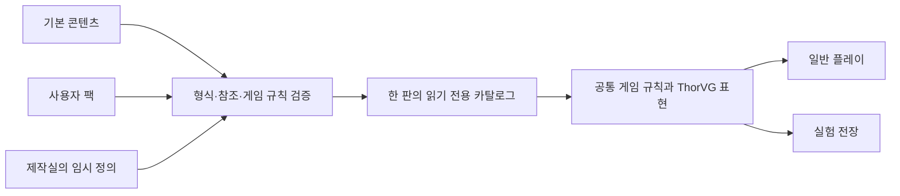

# 유저 몬스터 제작과 샌드박스 확장안

작성일: 2026-10-31. 사용자가 제안한 후속 확장 방향을 정리합니다. 몬스터 추가·실험 전장은 검토 방향이며 에디터·파일 포맷·스크립트 실행의 구현 승인을 의미하지 않습니다. [통합 기획](archive/game-design.md), [코드 구조](archive/architecture.md), [결정 기록](archive/decisions.md)의 D-29·Q-21과 함께 관리합니다.

## 플레이어가 할 수 있게 만들 기능

**몬스터 제작 → 실험 전장에서 소환 → 카드·타워로 상대 → 수정 → 파일로 공유**하는 흐름을 제안합니다. 게임의 기본 몬스터도 같은 정의 형식과 실행 규칙을 사용하면 제작실에서 조정한 결과가 실제 전투와 연결됩니다.

| 기능 | 플레이어의 조작 예시 |
| --- | --- |
| 몬스터 만들기 | 이름·체력·이동 속도·거점 피해 조정 |
| 능력 조합 | 엔진이 지원하는 분열·방어막·사망 시 폭발 등의 프리셋 선택 |
| 외형 연결 | 기본 외형 선택, 이후 사용자 Lottie 에셋과 상태별 구간 연결 |
| 실험 전장 | 경로·타워를 정하고 적 수·간격·웨이브 편집 |
| 실험 도구 | 일시정지·재시작·배속·에너지 설정, 체력·사거리·처리량 확인 |
| 내보내기·불러오기 | 몬스터 정의와 에셋을 묶어 다른 사람이 시험 |

예를 들어 ‘느리지만 체력이 높은 수정 슬라임, 사망하면 작은 슬라임 둘로 분열’을 만들고, 경비병의 저지와 포격탑 조합을 시험할 수 있습니다. 분열 등은 엔진에 해당 프리셋을 구현한 뒤 제공하는 예시이며 현재 구현된 능력이 아닙니다.

## 데이터 추가와 새 행동 구현의 범위

| 범위 | 가능한 변화 | 필요한 작업 |
| --- | --- | --- |
| 정의 데이터 | 체력·속도·태그·외형·기존 능력 조합 | 지원하는 정의 파일 또는 에디터에서 작성 |
| 새 능력 유형 | 아직 없는 이동·공격·상태 상호작용 | 엔진에 타입·규칙·테스트 추가 |
| 사용자 스크립트 | 사용자가 직접 행동 로직 작성 | 별도 실행 환경·API·작업량 제한 설계, 장기 검토 |

첫 후속 단계는 수치와 능력 프리셋을 조합하는 데이터 방식입니다. 이것만으로 기본형·고속형·장갑형과 다양한 변형을 표현할 수 있게 설계하되, 임의의 새로운 행동까지 파일만으로 구현할 수 있다고 약속하지 않습니다. 사용자 코드를 실행하는 모드는 별개의 후속 기능입니다.

## 지금의 구조에서 준비할 경계

### 몬스터 정의와 실행 중 상태

아래는 개념적인 타입·단위 제안이며 확정 스키마나 ABI가 아닙니다.

| 정의 항목 | 타입·단위 제안 | 책임 |
| --- | --- | --- |
| 정의 ID | 네임스페이스가 있는 문자열 | 종류 식별, 예: 기본 팩과 사용자 팩 구분 |
| 표시 이름 | 문자열 | 제작실·도감의 이름 |
| 최대 체력 | 양의 정수 | 전투 능력치 |
| 이동 속도 | 유한한 실수, 논리 타일/초 | 경로 이동 |
| 거점 피해 | 0 이상의 정수 | 도달 시 거점 피해 |
| 이동·교전 규칙 키 | 지원 목록의 ID | 기존 규칙 선택 |
| 능력 목록 | 타입이 있는 능력 정의 배열 | 지원하는 능력과 매개변수 |
| 외형 키 | 에셋 ID | Lottie 또는 기본 외형 참조 |

정의는 읽기 전용 콘텐츠 카탈로그에 두고, 현재 체력·위치·쿨다운·저지 관계는 판 안의 개체 상태에 둡니다. JSON 필드를 매 적의 매 프레임에 해석하지 않고 로딩 시 타입이 있는 정의와 지원 규칙으로 변환하는 안입니다. 몬스터 종류마다 별도 C++ 클래스를 만드는 구조는 첫 선택으로 두지 않습니다.

### 외형과 전투 판정

Lottie의 크기·색·움직임과 논리 충돌·저지 범위는 별도 값입니다. 이동·공격·사망 상태가 사용할 애니메이션 구간을 외형 정의에서 연결합니다. 피해와 분열·보상은 전투 규칙이 처리하고 애니메이션 완료 콜백이 처리하지 않습니다. 외형을 교체해도 같은 몬스터의 전투 결과가 유지되어야 합니다.

에셋 키만 게임 정의에 두고 ThorVG 객체와 원본 바이트의 수명은 렌더러·에셋 로더가 관리합니다. 사용자 Lottie의 지원 기능·복잡도·파일 크기 기준은 실제 렌더링 측정 뒤 정합니다.

### 공통 콘텐츠 경로

검증한 후보 전체를 한 번에 적용하고 실행 중인 판의 정의는 고정하는 안입니다. 제작실에서 수정한 내용은 미리보기 또는 실험 재시작 때 반영합니다. 파일을 바꾼 순간 전투 중 체력·능력 정의가 섞이지 않게 합니다. 실험 전장도 같은 전투 규칙을 사용하며 설정 명령과 결과 표시를 추가합니다.

## 후속 콘텐츠 팩의 후보 구성

- 팩 정보: 팩 ID·버전·스키마 버전·대상 콘텐츠 버전·작성자·설명·에셋 출처.
- 정의: 몬스터와 실험용 웨이브, 필요하면 맵 참조.
- 에셋: 팩 내부의 Lottie·이미지 등 지원 파일.

초기 공유는 로컬 파일 내보내기·불러오기부터 제안합니다. 폴더 묶음·ZIP 등 정확한 포맷과 라이브러리는 선택하지 않았습니다. 온라인 업로드·검색·계정·평점은 별도 서비스 범위로 둡니다.

네임스페이스로 이름 충돌을 구분하고 중복 정의 ID는 명시적으로 오류 처리합니다. 묵시적인 덮어쓰기는 첫 규칙에 포함하지 않습니다. 한 판의 빌드·팩 버전 또는 내용 식별값·시드를 기록해 같은 콘텐츠 조합의 문제 장면을 재현할 수 있게 합니다.

일반 플레이와 실험 전장의 진행 기록은 분리하는 안을 권장합니다. 자유 소환·에너지 설정으로 시험한 결과를 기본 도감·출발 편성 기록에 섞지 않고, 사용자 팩의 진행 기록을 둘지는 별도로 정합니다.

## 검증과 오류 표시

필수 필드·타입·허용 값은 포맷 검증에서, 없는 능력·에셋·분열 대상 같은 참조는 콘텐츠 검증에서 확인합니다. JSON을 선택하면 JSON Schema의 속성·필수 값·미지원 필드 정책을 활용할 수 있습니다. 구체 스키마 버전과 검증기는 미정입니다. [JSON Schema 공식 문서](https://json-schema.org/understanding-json-schema/reference/object)

제작실은 어느 몬스터의 어느 필드가 잘못됐는지 표시하고 이전에 동작하던 정의를 유지합니다. 파일 불러오기에 실패하면 현재 판과 도감을 바꾸지 않는 방식입니다. 팩 내부 파일 참조와 지원 에셋만 처리하는 범위를 먼저 정합니다.

물량을 만드는 능력에는 전장 개체 수·분열 세대·누적 생성 수 등의 실행 예산이 필요합니다. 순환 참조만 검사하는 것으로 끝내지 않고 같은 세대에서 폭발적으로 늘어나는 생성도 다룹니다. 수치 한계와 Lottie 예산은 성능 측정으로 정합니다.

사용자 스크립트를 도입한다면 노출할 API·상태 접근·실행 취소·작업량 제한을 별도 설계해야 합니다. WebAssembly의 모듈 격리는 호스트 API와 실행 환경의 정책을 따릅니다. 게임을 WASM으로 빌드했다는 사실만으로 모드 실행 정책까지 정해진 것으로 취급하지 않습니다. [WebAssembly 공식 보안 모델](https://webassembly.org/docs/security/)

## 단계별 도입 제안

| 단계 | 범위 | 확인할 결과 |
| --- | --- | --- |
| 첫 게임 구현 | 기본 몬스터 3역할의 외부 정의와 공통 로딩·참조 검증 | 게임 코드 변경 없이 지원 범위의 수치·외형 교체 |
| 후속 1 | 실험 전장, 기본 몬스터 복제·수치 편집 | 같은 규칙으로 재시작·비교 가능 |
| 후속 2 | 지원 능력 조합·Lottie 연결·팩 파일 공유 | 사용자 몬스터를 작성·불러와 플레이 |
| 장기 검토 | 새 맵·카드 제작, 온라인 공유, 스크립트 | 실제 요구를 보고 개별 범위 결정 |

첫 3웨이브 연결판에 제작실·사용자 팩 UI·스크립트 런타임은 추가하지 않는 추천안입니다. 기본 콘텐츠를 정의와 실행 상태로 나누는 기존 구조를 유지하고, 게임의 재미를 확인한 뒤 후속 기능을 승인받아 구현합니다.

## 구현 시 테스트할 항목

- 지원하는 기본 정의와 같은 내용의 사용자 정의가 같은 규칙 결과를 냄.
- 없는 능력·에셋·분열 대상, 중복 ID·미지원 버전·잘못된 타입을 명확하게 거절함.
- 로딩 실패·수정 실패 뒤 이전 카탈로그·진행 기록·실행 중 상태가 유지됨.
- 분열·주기 생성·반복 웨이브가 실행 예산을 넘어 계속 개체를 만들지 않음.
- 외형 교체·애니메이션 속도 변경이 피해·보상·저지 판정을 바꾸지 않음.
- 일반 플레이와 실험 기록이 섞이지 않고 팩 변경 뒤 저장 참조를 재검증함.
- 같은 빌드·콘텐츠·시드에서 정한 재현 조건을 만족함.

위는 향후 게임 테스트 계획입니다. 현재 콘텐츠 로더·팩 포맷·몬스터 에디터는 구현하지 않았습니다.
